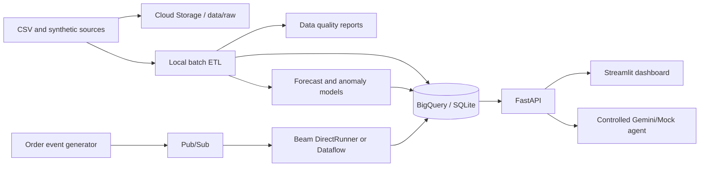

# RetailPulse

RetailPulse is a local-first retail and supply-chain intelligence platform. It generates
synthetic data, validates and transforms it into analytical tables, trains demand and
anomaly models, exposes metrics through FastAPI, and provides a Streamlit dashboard.
Google Cloud integrations are opt-in and credential-gated.

## Quickstart

```bash
python3.11 -m venv .venv
source .venv/bin/activate
pip install -e ".[dev]"
cp .env.example .env
python -m retailpulse.ingestion.generate --records 50000 --output data/raw
python -m retailpulse.processing.batch --input data/raw --output data/processed
python -m retailpulse.ml.train --input data/processed --output models
uvicorn retailpulse.api.main:app --reload
```

In another terminal:

```bash
streamlit run frontend/app.py
```

The API is documented at http://localhost:8000/docs. `RETAILPULSE_MOCK_AGENT=true`
provides a deterministic assistant without Gemini credentials.

## What is implemented

- Reproducible synthetic products, warehouses, inventory, orders, and 50,000+ sales records.
- Schema, null, duplicate, referential-integrity, and rejected-record reporting.
- Local Parquet/CSV batch pipeline and SQLite analytical repository.
- Event generator and Beam-compatible local streaming transform with event-time windows,
  deduplication, late-event handling, retries, and dead-letter output.
- Moving-average and seasonal-naive demand forecasting with MAE/RMSE/MAPE, plus
  Isolation Forest anomaly detection.
- FastAPI analytics API and controlled mock/Gemini agent tools.
- Streamlit/Plotly dashboard, Docker Compose, GitHub Actions, Terraform examples, and
  Cloud Build configuration.

## Commands

```bash
pytest
ruff check src tests frontend
python -m retailpulse.streaming.producer --events 100
python -m retailpulse.streaming.pipeline --input data/sample/events.jsonl
```

See [docs/deployment.md](docs/deployment.md) for Google Cloud deployment. GCP services
are not provisioned automatically; BigQuery, Pub/Sub, Dataflow, Cloud SQL, Cloud Run,
Cloud Storage, IAM, Monitoring, and Logging adapters require explicit credentials and
configuration.

## Architecture



## Limitations

The local mode intentionally uses SQLite and JSONL so it works without paid services.
Cloud adapters are reference implementations and deployment templates, not a claim that
resources have been created. Use synthetic identifiers only and never commit credentials
or generated large datasets.
